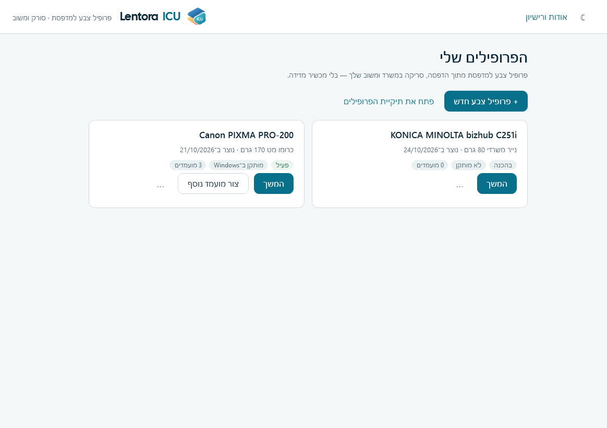
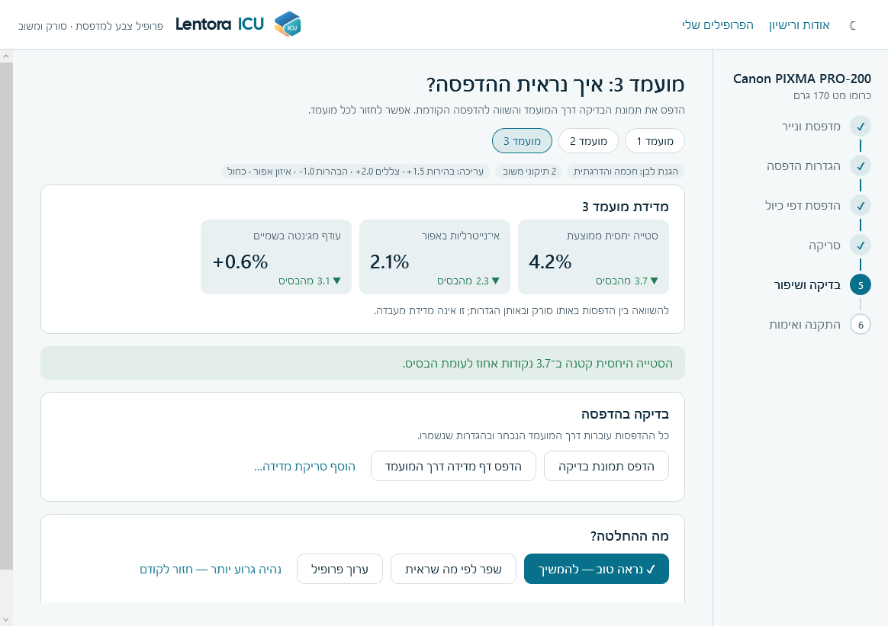
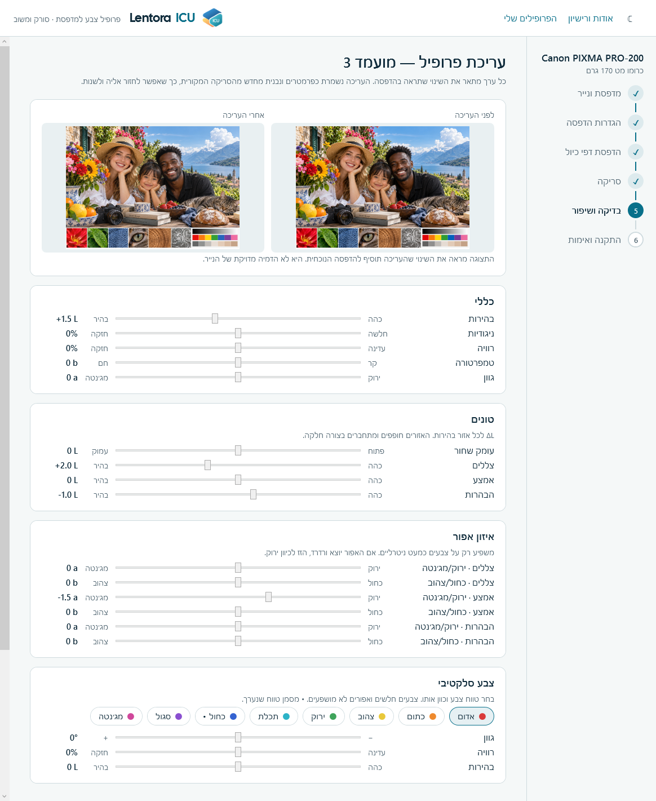
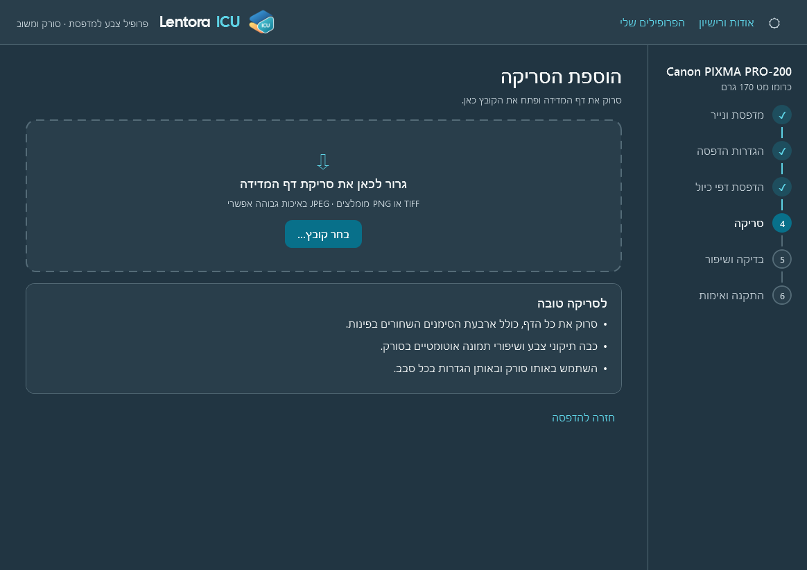

# Lentora ICU

פרופיל צבע (ICC) למדפסת מתוך הדפסה, סריקה בסורק משרדי ומשוב אנושי — בלי מכשיר מדידה.
אפליקציית Windows ב־C# / .NET 8 / WPF. קוד פתוח תחת **AGPL-3.0-or-later**.

**הורדה:** [הגרסה האחרונה ב־Releases](https://github.com/hadishisrael-hub/lentora-icu/releases/latest) — קובץ התקנה ל־Windows 10/11 (64 סיביות), בלי הרשאות מנהל וללא התקנות נוספות.



| בדיקת מועמד | עורך הפרופיל | ערכה כהה |
|---|---|---|
|  |  |  |

## איך זה עובד

1. בוחרים מדפסת ונייר ושומרים את הגדרות ההדפסה.
2. מדפיסים דף מדידה **לאורך** ותמונת בדיקה **לרוחב**.
3. סורקים את דף המדידה ופותחים את הסריקה בתוכנה.
4. התוכנה בונה מועמד ICC. מדפיסים דרכו, משווים ומשפרים: במשוב (בעיות מוכרות בעוצמה 1–4) או בעורך הפרופיל (ערכים מדויקים). אפשר לשמור עד שמונה מועמדים ולחזור לכל אחד.
5. מתקינים את הפרופיל ב־Windows ומבצעים הדפסת אימות אחרונה.

## עורך הפרופיל

כל מועמד שומר את העריכה שלו כפרמטרים, ונבנה מחדש מהסריקה המקורית. לכן אפשר לפתוח מועמד, לשנות ערך ולבנות ממנו מועמד חדש, בלי לאבד את הקודמים. כל ערך מתאר את השינוי שיראו בהדפסה, ביחידות Lab:

- **כללי:** בהירות (ΔL ±8), ניגודיות (±25%), רוויה (±30%), טמפרטורה (Δb ±8), גוון ירוק/מג׳נטה (Δa ±8).
- **טונים:** עומק שחור, צללים, אמצע והבהרות (ΔL ±8, אזורים חופפים וחלקים).
- **איזון אפור:** Δa ו־Δb לצללים, לאמצע ולהבהרות (±6). משפיע רק על צבעים כמעט ניטרליים.
- **צבע סלקטיבי:** שמונה טווחי גוון. לכל אחד אפשר להזיז את הגוון (±20°), לשנות רוויה (±40%) ובהירות (ΔL ±8). אפורים לא מושפעים.

תצוגה מקדימה חיה מראה את השינוי המכוון על תמונת הבדיקה. הגנת לבן הנייר חלה גם על העריכה. העריכה פועלת רק על פרופילים שנוצרו ב־ICU, כי נדרשת הסריקה המקורית.

קובצי הסריקה, התרשים, המדידות, ה־ICC, הגרסאות והיומנים נשמרים תחת `%LOCALAPPDATA%\PrinterColorProfiler\Profiles`.
שם קובץ ICC מיוצא חייב להיות ASCII (אנגלית, ספרות, מקף או קו תחתון) לתאימות עם תוכנות גרפיקה; תיאור הפרופיל בתוך ה־ICC הוא באנגלית.

במסך בדיקת המועמד אפשר להדפיס דף מדידה דרך המועמד ולסרוק אותו. התוכנה מציגה סטייה יחסית ממוצעת, אי־נייטרליות באפור ועודף מג׳נטה בגוני שמיים, ומשווה לדף הבסיס.
הגנת לבן הנייר (חכמה והדרגתית כברירת מחדל, לבן מוחלט בלבד, או מורחבת) מרסנת תיקונים ליד לבן הנייר. ממצאי המימוש והבדיקות: [docs/evidence/paper-white](docs/evidence/paper-white/PaperWhite-Protection-Report.md).

## מגבלות מדידה והתקנה

המדידה מבוססת על סורק משרדי, ולכן היא יחסית ואינה שקולה למדידה בספקטרופוטומטר. התוכנה בודקת את עקביות הטלאים החוזרים, מנרמלת לפי לבן הנייר ומתקנת נטייה מרחבית קלה. ציר האפור מספק מדד לסטייה אך אינו מנוטרל אוטומטית, כי ללא יעד מדידה חיצוני אי אפשר לדעת אם הסטייה נגרמה במדפסת או בסורק. יש להשתמש באותו סורק ובאותן הגדרות בכל איטרציה.

התקנת ICC לספריית הצבע של Windows עשויה לדרוש הרשאת מנהל. התוצאה תלויה גם בניהול הצבע של הדרייבר; בדיקת ההדפסה האחרונה נועדה לזהות אי־התאמה בין הדפסת המועמד להדפסה דרך הפרופיל המותקן.

## בנייה

דרוש .NET 8 SDK. ArgyllCMS 3.5.0 (הארכיון הרשמי הלא־משונה מ־[argyllcms.com](https://www.argyllcms.com/downloadwin.html)) צריך להיות בתיקייה `Argyll_V3.5.0` לצד ה־EXE, או שמגדירים את `PRINTER_PROFILER_ARGYLL` לתיקיית `bin` שלו. הוא לא נשמר בריפו.

```powershell
dotnet build .\Smoke\Smoke.csproj -c Release --configfile .\NuGet.Config
.\Smoke\bin\Release\net8.0-windows\Smoke.exe                      # תרשים, פרספקטיבה, הגנת לבן; כש־Argyll זמין גם 30 בניות ICC שבודקות את כיוון כל תיקון ועריכה
.\Smoke\bin\Release\net8.0-windows\Smoke.exe --verify-chart .\PrinterColorProfiler\Assets\CalibrationChart.png
dotnet run --project .\PrinterColorProfiler\PrinterColorProfiler.csproj
```

`PrinterColorProfiler.exe --render-screens <dir>` מצייר את כל המסכים בשתי הערכות מנתוני דמו בתיקייה זמנית, בלי לגעת בפרופילים או בהגדרות האמיתיים.

## רישוי ומותג

- הקוד: GNU Affero General Public License v3.0 or later — [`LICENSE`](LICENSE).
- השם Lentora / Lentora ICU, הלוגו והאייקון אינם כלולים ברישיון — [`TRADEMARKS.md`](TRADEMARKS.md). fork מופץ צריך שם ואייקון משלו.
- רכיבי צד שלישי ומקור ArgyllCMS — [`THIRD-PARTY-NOTICES.md`](THIRD-PARTY-NOTICES.md).
